# `/path` v3 benchmark: what makes the reference 3D sites feel cool, and what v2 lacks

Research for the v3 rebuild of `/path`. It inspects igloo.inc, bruno-simon.com and
jesse-zhou.com, the owner's screen recording, and v2 (`def0fa5`). It ends with a v3 spec that a
few Workers can build in parallel with plain three.js. The image-to-3D bake-off the owner asked for
is §5; this round it ran one model.

The owner's decisions frame everything below (the run's `brief-v3.md`):

- No text panel and no in-scene text. The voice tells each step, with small animations timed to
  it, and one caption line can be switched off.
- No budget limits for now; the fallbacks and the flat site stay.
- Everything solid 3D. Landmarks are rebuilt with the best image-to-3D model available.

Evidence frames are in [`path-v3-benchmark/`](path-v3-benchmark/), as WebP, each 150 KB or less.

## 1. Method

- **Browser.** Playwright 1.62 Chromium, headless, launched with `--mute-audio`. Under ANGLE it
  ran on the real GPU (`ANGLE Metal Renderer: Apple M5`), so frame rates and effects are real,
  not SwiftShader's. Viewport 1440×900, plus 375×812 for v2's phone view.
- **Recording.** Playwright video, 30–40 s per site, covering the opening and the main interaction:
  - igloo: wait, click, then 24 wheel steps.
  - Bruno Simon: wait, click, then about 20 s of arrow-key driving.
  - jesse-zhou: START, a mouse sweep, then a click on the "projects" sign. An earlier run
    scrolled and zoomed the view out, so the evidence comes from the clean third run.
  - v2: the self-playing tour for 16 s, then "Next step" pressed every 3.5 s to the end.
- **Frames.** Pulled with ffmpeg every 2 s, plus 4–10 fps strips around the transitions. I looked
  at every contact sheet and every strip used here.
- **Inspection.**
  - An init script wrapped `getContext`, `shaderSource`, `createProgram`, `texImage2D`,
    `texStorage2D`, `createFramebuffer` and the draw calls, plus `requestAnimationFrame`,
    `AudioContext` and WebGPU's `createShaderModule`.
  - Every response's decoded size and content type was logged.
  - Every JS, WASM and JSON body was saved and grepped for engine and pass names.
- **The owner's video.** `Screen Recording 2026-10-28 at 20.53.18.mov`: 27.9 s, 1468×824. Frames
  were pulled at 1 fps for the whole clip and at 5 fps around the marker's moves.
- **v2.** Recorded against this worktree's own dev server on port 3261, so its JS is the
  unminified dev build. Its byte counts are not comparable with the references' production
  bundles; `docs/path-measurements.md` has v2's production numbers.

Byte counts below are decoded bodies for what each session actually fetched. They are a floor:
content behind interactions I did not reach was never requested.

## 2. Per reference: what produces the feeling

### 2.1 igloo.inc

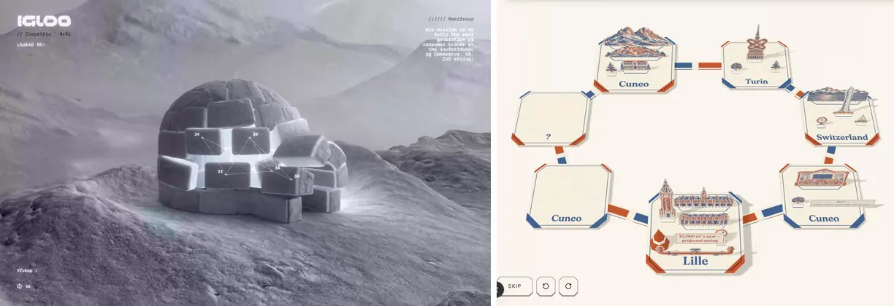

_Left: igloo after the intro. Right: v2's board at the same moment in its tour._

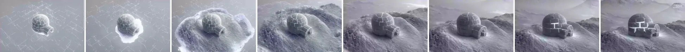

_igloo's intro, 3.2 s at 2.5 fps: a wireframe igloo in a lattice, then ground that grows outward
from it, then lit seams._

- **Camera.** A slow, low three-quarter on one hero object, close enough that it fills a third of
  the frame. Scrolling drives the camera along an authored path: a dive into fog, past floating
  "portfolio" rocks, through a ring portal.
  - It never cuts. The scroll position is the timeline (`ScrollTrigger`, plus a
    `scroll-datatexture.ktx2` that feeds the shaders).
  - Easing is scroll-scrubbed, so it is as smooth as the input.
- **Lighting and materials.** Physically based, with baked colour maps per object
  (`igloo_color`, `ground_color`, `mountain_color` as KTX2), an EXR environment (`cubes_env.exr`,
  259 KB) and transmissive ice whose shader carries `uChromaticAberration`.
  - The shaders reference `lightMap` and `aoMap` throughout.
  - The palette is almost monochrome: cool greys and white.
- **Post-processing.**
  - pmndrs `postprocessing`: `BloomEffect` with a luminance threshold, and `SMAA` with depth
    predication.
  - A custom final composite with a 3D LUT (`tLUT`, `uLUTIntensity`), film grain and a blue-noise
    texture (`tBlue`) for dithering.
  - A scene-to-scene blend (`tScene1`, `tScene2`, `tScroll`).
  - Fog everywhere: 91 shader references.
  - Chromatic aberration shows at the frame edges.
- **Motion.**
  - The intro materialises the scene: wireframe, then the ground grows radially from the object
    under a noisy edge (about 2.5 s), then light leaks through the block seams.
  - The igloo's blocks drift apart and back.
  - Particles and volumetric smoke come from `Data3DTexture` volumes (`peachesbody_64.ktx2`).
  - Snow is ever-present.
- **Sound.**
  - 17 OGG files: three ambient beds (`music-highq` 1.5 MB, `room` 610 KB, `wind` 573 KB) and 14
    UI one-shots of 3–62 KB each: `click-project`, `enter-project`, `shard`, `beeps`.
  - They are decoded in an audio worker.
  - The UI reads "Sound: On". The files were fetched at 7.2 s, before my first click at 9.4 s.
- **Interaction feedback.** Hovered rocks get MSDF HUD callouts with leader lines, and every
  action has a sound. The callouts are text in the scene, which the owner has ruled out for us.
- **Load.**
  - About 8 s of a flat grey page with one thin progress line (in
    [`08-load…`](path-v3-benchmark/08-load-igloo-jesse-bruno-vs-v2.webp), left).
  - Then the materialise above.
  - Heavy assets are decoded in workers (bitmap, EXR, MSDF, audio).
- **Cost.**
  - 17.5 MB decoded (15.6 MB over the wire) by the end of the session.
  - KTX2 textures 11.0 MB, audio 2.9 MB, JS 1.8 MB (`App3D` alone 1.5 MB), WASM 0.76 MB
    (Basis, Draco), Draco geometry 0.56 MB (the igloo 223 KB, most others 1–44 KB), EXR 0.26 MB.
  - three.js r165 on WebGL2: 91 programs, 46 framebuffers.

### 2.2 bruno-simon.com

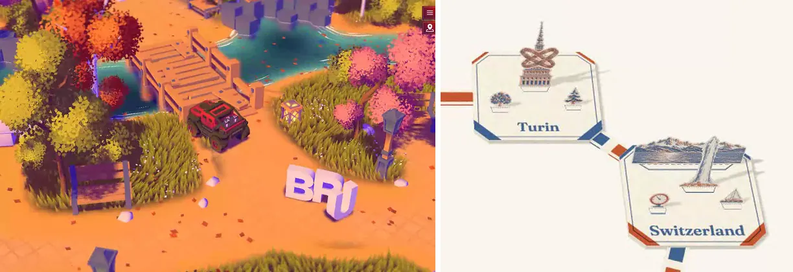

_Left: Bruno's island while driving. Right: v2's board, close._

- **Camera.** A high follow-cam at about 50° down, at a fixed yaw, trailing the car with spring
  lag. It is close enough that the car is about a tenth of the frame width, with the world
  around it readable.
  - Tilt-shift blur bands at the top and bottom of the frame make it read as a miniature. They
    are plain in the left frame of pair 05.
  - The intro drops from above onto the spawn.
- **Lighting and materials.**
  - Stylised, not PBR-real: saturated warm ground, purple and blue shadow tints, and ramp-like
    shading.
  - Foliage is clusters of dithered pixel-noise cards; grass is instanced blades; the water has
    animated foam lines.
  - Lightmaps and AO are referenced throughout (`lightMap` 65, `aoMap` 64), and the terrain is one
    350 KB KTX.
- **Post-processing.** Bloom (TSL `bloom`), TAA, tone mapping (AgX and ACES both referenced) and
  the tilt-shift bands. All of it is WebGPU node-material code (TSL): 200 WGSL modules were
  captured, with names stripped.
- **Motion.**
  - Everything moves a little: grass sways, leaves fall, water foams.
  - The big 3D "BRUNO SIMON" letters are physics bodies the car knocks over (Rapier, 1.7 MB WASM).
  - Crates scatter.
- **Sound.** Howler. A 6.2 MB music track (`Sudo.mp3`), loops for lake waves, wind, rain and
  chimes, and engine sounds: 9.4 MB of MP3 in total. The first audio request went out at 1.6 s,
  before any interaction.
- **Interaction feedback.**
  - Collisions with physical consequence, and dust and splash particles.
  - An achievements toast ("I'm going on an adventure!").
  - A map button to jump between areas.
- **Load.**
  - A glowing ring on a dark isometric grid, for about 20 s in this headless session before the
    island appeared. I could not tell how much of that was loading and how much was waiting for
    input.
  - Then the camera drops in.
- **Cost.**
  - 20.3 MB decoded (15.2 MB over the wire).
  - Audio 9.4 MB, JS 5.2 MB (main bundle 4.9 MB), WASM 2.5 MB (Rapier 1.7, Basis 0.53,
    Draco 0.29), GLB 1.0 MB, KTX 0.87 MB.
  - three.js r183 with `WebGPURenderer` and TSL; the canvas context was `webgpu`.

### 2.3 jesse-zhou.com

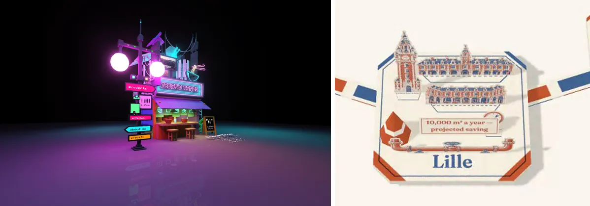

_Left: jesse's ramen stall after START. Right: v2's Lille tile, close._

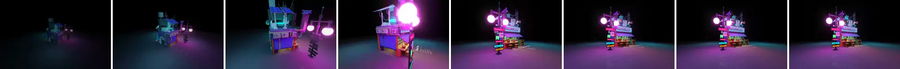

_START to rest, 2 s at 4 fps: the stall fades in from behind, and the camera arcs close around it
and pulls back to the hero framing._

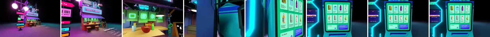

_A click on "projects", 1.6 s at 5 fps: a hold, then a fast push through the stall onto a vending
machine whose screen is the projects UI._

- **Camera.**
  - **Hero framing.** A single diorama centred, slightly low, with a long lens, filling about half
    the frame height.
  - **Intro swoop.** Measured at about 1.8 s from fade-in to rest. It starts behind the stall,
    arcs close past the lamps, and pulls back. It is ease-in-out, closest at the midpoint.
  - **Navigation.** A click holds about 0.5 s, then flies about 1.2 s into an in-world screen
    (CatmullRom paths and GSAP tweens). It decelerates hard into the shot.
  - Limited OrbitControls at rest.
- **Lighting and materials.**
  - Fully baked: four 1024² KTX2 bakes (`floorBaked1024` 722 KB, `ramenShopBaked1024` 548 KB,
    `machinesBaked1024` 515 KB, `miscBaked1024` 461 KB).
  - Emissive neon on top, and a `Reflector` floor that mirrors it in purple and cyan.
  - Blender-quality GI and AO at almost no runtime cost.
- **Post-processing.** `EffectComposer` with `UnrealBloomPass` (what makes the lamps blow out)
  and `SMAA`.
- **Motion.** Video textures on the stall's screens (MP4, 1.0 MB in total), steam, and a small
  hologram. Otherwise the diorama is still: the life comes from light and screens.
- **Sound.** Howler; one ambient track (784 KB) and small effects. The first audio request went
  out at 0.8 s, before START.
- **Interaction feedback.** Hovering a sign brightens it, and every click is a camera move to an
  in-world surface. That surface is the UI.
- **Load.** A drawn loader ("Cooking your ramen… 33%") for about 5 s, then a START button, then
  the swoop.
- **Cost.**
  - 10.4 MB decoded (8.0 MB over the wire): KTX2 4.3 MB, glTF 1.6 MB, JS 1.1 MB, video 1.0 MB,
    audio 0.9 MB, WASM 0.78 MB.
  - three.js r139: 26 programs, 17 framebuffers.

### 2.4 The owner's video (grammar only; §6.6's rule: borrow none of its props)

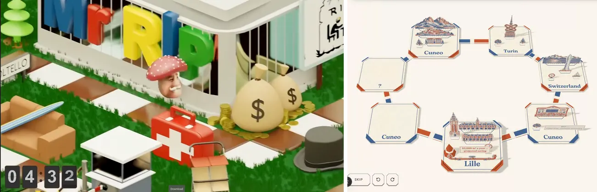

_Left: the owner's clip at 10 s. Right: v2's board while the tour plays._

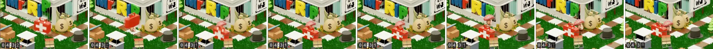

_1.6 s at 5 fps: the marker walks the checker path past a prop cluster. A prop beside the path
leaps, flips and lands as the marker arrives._

- **Camera.**
  - **Angle.** One fixed angle, an isometric-like three-quarter at roughly 35–40° down and 45°
    yaw. The lens is long, so verticals barely converge.
  - **Distance.** Close: two or three prop clusters fill the frame, and the marker is about a
    twelfth of the frame width.
  - **Movement.** The camera trucks continuously to keep the marker a little behind centre in its
    direction of travel, with a soft lag. It never cuts and never zooms out to the whole board.
  - **Pacing.** The clip opens on a held still of about 4 s, then about 22 s of steady travel.
    The path turns, and the camera turns its course with it.
- **The marker.**
  - It walks rather than teleports: about one tile every 0.5–0.6 s, with a small bob per step.
    v2's `HOP_MS` is 560, so the pace matches. The framing is what differs.
  - It is occluded by props it passes behind, which sells the depth.
- **Props.**
  - Dense solid clusters along the path, all toy-like: rounded edges, glossy plastic and painted
    wood.
  - Grass has blade tufts.
  - Soft global illumination, contact AO under everything, and gentle depth of field at the
    frame edges.
  - It is almost certainly a pre-rendered Blender clip; I read that from the GI and the clean
    motion blur, not from metadata.
  - Props react to the marker: a case jumps and flips (about 0.6 s), and tentacles rise out of a
    building and wave as it passes. That is the "small animations" grammar the owner asked for.
- **Overlay.** One small persistent HUD element, a flip-clock countdown at the bottom left. There
  is no text panel.

### 2.5 v2 (`def0fa5`), for comparison

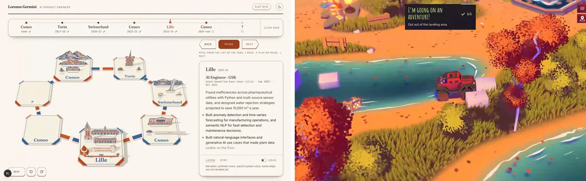

_Left: v2 at 1440×900, with the step list, the transport, and the text panel taking the right
third. Right: Bruno's screen, nearly all world._

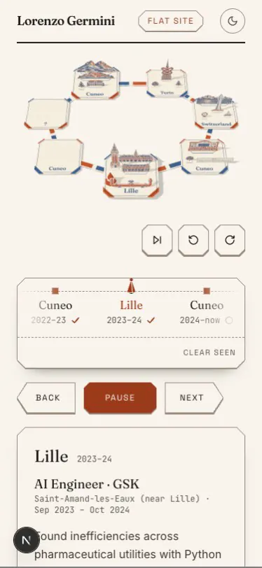

_v2 at 375×812: the board is a strip of about 140 px, and the text takes the rest._

- **Camera.**
  - One framing of the whole loop, from high and near top-down. A selection eases the focus
    (`FOCUS_MS` 900), but the board stays at overview scale, so the pawn and the cards are small.
  - There is no close-up and no travel shot.
- **Lighting and materials.**
  - Flat, even daylight: a `HemisphereLight` at 2.3 and one `DirectionalLight` at 1.25 with a
    768² PCF shadow, on a `ShadowMaterial` table.
  - Cards are ink-separation textures on planes; tiles are thin slabs. No AO, no environment and
    no material response.
- **Post-processing.** None: 5 programs, and 4 framebuffers, which are the shadow map.
- **Motion.** Cards fold up with a spring (520 ms, bounce 0.22), staggered 110 ms. The pawn hops.
  Nothing moves at rest.
- **Sound.** The optional voice only.
- **Load.** The board paints at once, behind a first-paint guard. This is better than every
  reference; keep it.
- **In-scene text.** Tile names, and plaques such as "10,000 m³ a year — projected saving" and
  "MVP — killed after customer discovery". The owner has ruled these out.

## 3. Ranked gaps against v2

Ranked by how much each one closes the distance to "cool". The evidence column points to the
frame pairs.

| #   | Gap                                                                                                                                                                                                                                                                      | Reference evidence            | Frames         |
| --- | ------------------------------------------------------------------------------------------------------------------------------------------------------------------------------------------------------------------------------------------------------------------------ | ----------------------------- | -------------- |
| 1   | **The camera never gets close or travels.** One overview of the loop, so nothing has presence. The references live at close range: the owner's clip, jesse's hero framing. They move between shots with authored dollies and swoops (jesse's 1.2 s fly-in, 1.8 s intro). | Owner's clip, jesse, igloo    | 01, 02, 11, 12 |
| 2   | **Flat cards instead of solid models.** Die-cut planes read as a printout at any distance. Every reference, and the owner, uses solid objects with thickness, bevels and occlusion.                                                                                      | Owner's clip, all three sites | 06, 03, 14     |
| 3   | **Flat light, no AO, no material response.** Even daylight and one shadow map. jesse's whole look is baked GI and AO; the owner's clip is GI with contact shadows; igloo's is PBR with an environment.                                                                   | jesse, owner's clip, igloo    | 03, 04         |
| 4   | **No post-processing.** No grade, bloom, depth of field, grain or anti-aliasing beyond the default. igloo uses bloom, a LUT, grain, blue-noise dither, SMAA and chromatic aberration; Bruno bloom, TAA and tilt-shift; jesse bloom and SMAA.                             | igloo, Bruno, jesse           | 04, 05         |
| 5   | **Text-first layout.** The panel takes a third of the desktop and most of a phone, and plaques put text in the scene. The owner has decided against both; the references give the world nearly the whole screen.                                                         | Bruno, jesse, owner's clip    | 07, 13         |
| 6   | **Nothing lives at rest, and props don't react.** Bruno's grass, leaves and water never stop. The owner's props jump and wave as the marker passes. v2 is still once the cards are up.                                                                                   | Bruno, owner's clip           | 05, 09         |
| 7   | **The arrival is a fold, not a materialise.** igloo grows its ground out from the object; jesse swoops in. v2's cards fold up in place, which reads as a UI transition.                                                                                                  | igloo, jesse                  | 10, 11         |
| 8   | **No sound design.** Every reference has an ambient bed and interaction one-shots; v2 has only the opt-in voice. (All three also fetch audio before consent, which v3 should not copy.)                                                                                  | igloo, Bruno, jesse           | none (audio)   |
| 9   | **Phone framing.** The board is a strip of about 140 px. The references keep a full-bleed canvas on a phone.                                                                                                                                                             | n/a                           | 13             |
| 10  | **Load, the reverse gap.** The references gate on 5–20 s loaders; v2 paints at once. Keep v2's behaviour; the materialise in gap 7 can play after paint instead of a loader.                                                                                             | igloo, jesse, Bruno           | 08             |

## 4. Recommended v3 spec

Plain three.js (the repo's r186, WebGL2) plus pmndrs `postprocessing` and N8AO, which both work
on vanilla three.js. WebGPU and TSL (Bruno) is a stretch with no visual payoff that WebGL2 cannot
reach here.

The seams stay where v2 put them. `stage-status.tsx` remains the contract between tour and stage:
the stage reports `settled` when its close-up has landed. Card art's manifest (`card-art.ts`) is
replaced by a model manifest of the same shape, `scene-assets.ts`: id, step, file, scale, anchor,
role, and `captionLine`.

Each work package is marked **[day]** (about a day of Worker time) or **[stretch]**.

### (a) Camera choreography for the self-playing tour [day]

This is the owner's grammar, made into shots. A camera rig with two targets, `position` and
`lookAt`, both driven by authored curves. A critically damped follow (half-life about 0.12 s,
`THREE.MathUtils.damp` or maath's `damp3`) keeps it smooth when a curve is interrupted.

- **Lens.** A 24° vertical FOV, long for the model-railway look of the owner's clip and Bruno's
  miniature. Elevation 35° at travel, 28° at close-up, and a fixed 45° yaw to the board's
  diagonal, so the angle reads as the owner's isometric one.

| Phase               | What the camera does                                                                                                                                                                                                  | Duration                                                              | Easing                                                        |
| ------------------- | --------------------------------------------------------------------------------------------------------------------------------------------------------------------------------------------------------------------- | --------------------------------------------------------------------- | ------------------------------------------------------------- |
| Opening             | From high over the whole board (about 70° down, board filling the frame), swoop down and round to the home tile at close-up. jesse's intro, scaled.                                                                   | 2.4 s, once, after first paint                                        | `easeInOutCubic` on the path; FOV 30° → 24°                   |
| Close-up (dwell)    | Hold on the step's diorama, which fills about 60% of the frame height, slightly off-centre for the caption line. A slow 6° orbit drift across the narration and a 1% breathing dolly.                                 | The voice clip, plus a 0.8 s tail (min 5 s, no voice: v2's `dwellMs`) | Linear drift; breathing sine at 0.15 Hz                       |
| Pull back           | Rise and widen to travel height (about 2.2× the close-up distance), keeping the pawn in frame.                                                                                                                        | 0.9 s                                                                 | `easeInOutCubic`                                              |
| Travel              | Truck along the path spline (CatmullRom through the tile centres) with the pawn, framed a little behind centre in its direction of travel, as in the owner's clip. The pawn hops a tile every 0.56 s (v2's `HOP_MS`). | The hops: 0.56 s × tiles                                              | Follow damping, half-life 0.12 s; camera lags the pawn 0.25 s |
| Push in             | Settle onto the next close-up, decelerating hard into the shot (jesse's fly-in).                                                                                                                                      | 1.2 s                                                                 | `easeOutQuart`; `settled` fires at the end                    |
| Landing beat        | Pawn lands with squash, the tile thumps 2 cm, a dust puff, then the step's build plays ((d)).                                                                                                                         | 0.35 s, overlapping the push-in's last 0.3 s                          | Spring, bounce 0.2 (v2's `spring`)                            |
| Skip (list or tile) | Fly in an arc over the board from the current shot to the target close-up; the pawn jumps there in one long hop. The camera does not truck tile by tile.                                                              | 1.1 s + a 0.3 s hold at the start (jesse's)                           | `easeInOutQuint`, the site's `cubic-bezier(0.77,0,0.175,1)`   |
| End (`next`)        | After `next`'s dwell, pull back to the opening's whole-board framing and hold. No loop.                                                                                                                               | 2.0 s                                                                 | `easeInOutCubic`                                              |

- **Pause.** Freezes the rig where it is, mid-curve.
- **Back and Forward.** Use the skip flight.
- **Fragments.** `/path#lille` opens straight at Lille's close-up, after a 1.2 s variant of the
  opening.

### (b) The asset approach [day per tile, landmarks a stretch]

The owner has already decided on solid 3D. The recommendation is a split by kind of object, under
one material treatment so that the parts match.

1. **Landmarks: image-to-3D.**
   - The pipeline is a GPT Image reference via `codex exec`, then image-to-3D, then cleanup:
     - decimate to about 8–10k triangles, plus a 2.5k LOD;
     - re-encode the textures at 1024², or 512² on phones;
     - glTF with `EXT_meshopt_compression`, and KTX2 textures;
     - bake AO.
   - **The model.** Hunyuan3D-2.1 is the only one measured so far (§5), and its belfry holds its
     silhouette to 2.5k triangles. Rerun the bake-off after the quota resets before fixing the
     choice per landmark type.
   - **Cost.** On Hunyuan3D-2.1's numbers, about 280 KB a landmark after cleanup.
2. **Tiles, path, pawn, trees, grass and water: code-modelled low-poly.** Parametric and cheap;
   they iterate in code, not in a generator. (The pawn is v2's cone, made solid; how the props
   are made is open, below.)
   - **Tiles.** Thick slabs: `ExtrudeGeometry` with a 3–4 mm bevel, the colour band as a second
     material, and a light card-grain normal map so the paper idea survives as a material.
   - **Pawn.** A lathe-turned solid cone with a bevelled rim.
   - **Trees.** Clustered icospheres, as instances.
   - **Grass.** Instanced blade tufts, swayed in the vertex shader (Bruno).
   - **Rivers and lake.** A plane with a scrolling normal and foam-line shader.
3. **One look over both.** Every material is `MeshStandardMaterial` at high roughness (0.7–0.9),
   for the toy and clay finish of the owner's clip.
   - Generated textures get an "ink grade" in `onBeforeCompile`: their albedo pulled about 35%
     toward the path palette (terracotta, slate, cream), so the riso palette carries over as
     colour, not as flat cards.
   - Code-modelled parts take the palette directly.
   - The palette stays in `globals.css` tokens, read at runtime as v2's `palette.ts` does.
     Scene art keeps ADR-0008's exemption.

**Assets per tile.** These are the props `src/data/path.ts` already names, in the same
`captionLine` order. Nothing new is invented; the ink plaques and labels go.

| Tile          | Landmark (image-to-3D)                                                      | Code-modelled                                                                                                                      | Notes                                                                                            |
| ------------- | --------------------------------------------------------------------------- | ---------------------------------------------------------------------------------------------------------------------------------- | ------------------------------------------------------------------------------------------------ |
| `home`        | The high school                                                             | The plateau between the rivers (extruded wedge), the two rivers (water shader), the Bisalta (low-poly twin-peaked backdrop), trees | The Bisalta could be generated too, but a code-modelled twin crest is cheaper and stays accurate |
| `turin`       | The Mole Antonelliana                                                       | Ferraris' coils (three tori around a rotor), two trees                                                                             | The Mole is the bake-off's second subject                                                        |
| `switzerland` | The Jet d'Eau's jetty (the plume is particles)                              | The lake (water shader) with the Chablais backdrop, Roche's dial (disc and needle), a sailboat                                     | The plume is better as GPU particles than as a mesh                                              |
| `cuneo-2022`  | The schoolroom (cut-away facade)                                            | The MVP window (frame, shutters, glass)                                                                                            | The window's dimming tells "killed"; no label                                                    |
| `lille`       | The Chamber of Commerce belfry (measured, §5), the Vieille Bourse courtyard | The pipe loop (tube along a spline), the clock face                                                                                | v2's Lille hero; the two biggest generated meshes                                                |
| `now`         | The office front                                                            | The startup's desk (desk, monitor, lamp)                                                                                           |                                                                                                  |
| `next`        | n/a                                                                         | The blank prop: a plinth with five empty clue slots                                                                                | Five slots, as the data says                                                                     |
| Side props    | n/a                                                                         | Quadrell and L'Oracolo della Ghigliottina as small solid objects                                                                   | Their form is for the art Worker; nothing in them is text                                        |

- **[day]** Each code-modelled tile.
- **[stretch]** The generated landmarks, until the bake-off has run (§5.4).

### (c) Lighting, materials and post-processing [day]

- **Renderer.** `WebGLRenderer` with AgX tone mapping, sRGB output, and a DPR cap of 2 on desktop
  and 1.5 on phones.
- **Lights.**
  - A soft `HemisphereLight`, sky cream to ground terracotta, about 0.6.
  - One sun at about 2.0 with a 2048² `PCFSoftShadowMap`, its frustum fitted to the current shot,
    not the whole board, so close-ups get crisp shadows.
  - `RoomEnvironment` through PMREM at intensity 0.4–0.6 for fill and soft speculars.
- **AO.**
  - Baked AO for every model: from the generator's texture where it has one, or baked in Blender
    or with three's `ProgressiveLightMap` for code-modelled parts.
  - On top, a screen-space pass: **N8AO** (`n8ao`, works with pmndrs `postprocessing`) at half
    resolution. This is what makes props sit on the tiles.
- **Post chain.** pmndrs `postprocessing`, in this order:
  1. `RenderPass`, then N8AO.
  2. `BloomEffect`, threshold high, for emissive accents only: lit windows, the monitor, the pipe
     loop's flow.
  3. A tilt-shift (`TiltShiftEffect`, or a `DepthOfFieldEffect` focused on the pawn). This gives
     Bruno's miniature look, and the owner's clip has the same soft edges.
  4. `LUT3DEffect` with two LUTs, light and dark, built from the path palette. This is the grade,
     as in igloo.
  5. `NoiseEffect`: paper grain at about 4% opacity, blended with `SOFT_LIGHT`.
  6. `VignetteEffect` (subtle), then `SMAAEffect`.
- **Dark mode.** Becomes night. The sun drops to a low moon, the hemisphere cools, windows and the
  monitor go emissive, and bloom carries them (jesse's look). It is the same models with a
  different lighting preset, crossfaded over v2's `THEME_MS`.
- **[day]** Everything above. **[stretch]** Lightmap baking for the code-modelled set.

### (d) Ambient life and narration-synced animations, with no text [day]

There are two layers, and neither uses text.

**At rest, always on (Bruno's lesson).**

- Grass sways in the vertex shader on a wind noise.
- Trees breathe: a 0.5% scale and a 1° sway, with each instance phase-offset.
- The rivers and the lake flow (scrolling normals and foam).
- Cloud shadows drift across the board: a scrolling cookie texture multiplied into the sun's
  light.
- The pawn idles with a 1–2% squash every 3 s.

**On narration.** Each prop already carries a `captionLine`. The voice manifest gains a `cues`
array of start times per line. Each line's props play their beat when that line starts; without
voice, the beats run on a 1.2 s stagger after `settled`.

The cue times are the seam with the v3-voice ticket: per-sentence `say` clips concatenated with
their offsets, or `say`'s own timing.

| Step          | Beat (on its line)                                                                                                                                                      |
| ------------- | ----------------------------------------------------------------------------------------------------------------------------------------------------------------------- |
| `home`        | The plateau rises out of the tile with igloo's radial reveal of the ground; the rivers start to flow; the school's windows warm on.                                     |
| `turin`       | The Mole rises; Ferraris' coils pulse in sequence and the rotor between them spins up.                                                                                  |
| `switzerland` | Line 1: the lake's surface stills and its reflection resolves. Line 2: Roche's dial needle sweeps. Line 3: the Jet d'Eau's plume climbs.                                |
| `cuneo-2022`  | Line 0: the schoolroom's lights come on. Line 1: the MVP window lights, then dims, and its shutters close.                                                              |
| `lille`       | Line 0: water runs through the pipe loop (an emissive pulse along the tube) and the clock hands sweep. Line 1: the belfry rises. Line 2: the courtyard's arcade lights. |
| `now`         | Line 0: the desk monitor glows on. Line 3: the office lights up.                                                                                                        |
| `next`        | The five empty slots pulse once each, left to right, and stay empty.                                                                                                    |

- **Landing on any tile** (from the owner's clip): props beside the path react as the pawn passes,
  with a 0.6 s hop and a quarter-flip of the nearest accent prop. A dust puff of about 12
  instanced sprites rises on landing.
- **The build** replaces v2's card fold. A landmark rises from below the tile on a spring
  (v2's `spring`, about 600 ms), while a noisy radial mask grows the tile's ground out from its
  base: igloo's materialise, about 1.2 s.

### (e) Sound design [day; earns its place as feedback, not as music]

- **One switch.** "Sound", off by default, enabling the voice and the effects together. If the
  owner wants the voice separately, it stays the existing Voice switch.
- **Nothing downloads before the switch is turned on.** All three references fetch audio before
  consent (§2); v3 does not.
- **Contents.**
  - Six one-shots: hop (a wood tick), land (a soft card thump), rise (a paper-and-wood slide),
    a prop beat (a soft mallet in two pitches), a skip whoosh, and the end chord.
  - One ambient bed: wind and birds, a 20 s loop.
  - Total about 200–300 KB as Opus in WebM, with an AAC fallback for Safari.
  - Licensed (CC0, or recorded) and logged in `docs/path-assets.md`.
- **Engine.** Plain Web Audio, not Howler. The bed ducks 9 dB under the voice with a 150 ms
  ramp. Hop pitches vary ±3% so repeated hops do not sound mechanical.
- **No music.** Bruno's 6 MB track is the clearest case of cost without payoff for this page.

### (f) How each piece degrades

| Piece             | Reduced motion                                                                                      | Phones                                                                                                                                                  | Stills fallback (no WebGL, software renderer, lost context)                                                                  |
| ----------------- | --------------------------------------------------------------------------------------------------- | ------------------------------------------------------------------------------------------------------------------------------------------------------- | ---------------------------------------------------------------------------------------------------------------------------- |
| Camera            | No autoplay (as v2). Selections cut to the close-up with a 150 ms crossfade. No drift or breathing. | Portrait close-ups re-framed: FOV 30°, the landmark centred higher, with the caption line below. Travel height ×1.3.                                    | Stills are re-rendered from the v3 scene at each close-up (`scripts/render-path-stills.ts` already renders from the runtime) |
| Models            | Shown built                                                                                         | The 2.5k LOD and 512² textures                                                                                                                          | n/a                                                                                                                          |
| Lighting and post | Static; the grain is frozen                                                                         | N8AO dropped (baked AO only); tilt-shift and SMAA kept; bloom at half resolution. An adaptive-quality governor drops AO, then DPR, when frames run long | Baked into the stills                                                                                                        |
| Ambient life      | Off; end states shown                                                                               | Grass density halved; cloud shadows kept                                                                                                                | n/a                                                                                                                          |
| Narration beats   | Props shown in their end state, with no beat motion                                                 | As desktop                                                                                                                                              | n/a; the caption line and the flat site carry the words                                                                      |
| Sound             | Unchanged (opt-in)                                                                                  | Unchanged; unlocked by the switch's tap                                                                                                                 | Effects off; the voice still works                                                                                           |

The flat site stays one click away. The single caption line, which can be switched off, is the
on-screen text, set in the overlay rather than in the scene.

### Work packages for parallel Workers

| Package                                                            | Size                                              | Depends on                               |
| ------------------------------------------------------------------ | ------------------------------------------------- | ---------------------------------------- |
| W1 Camera rig and choreography (a)                                 | [day]                                             | the path spline from W3                  |
| W2 Landmarks: bake-off rerun, cleanup script, five landmarks (b)   | [stretch]: 1 day for the script and two landmarks | the quota; the tooling approvals in §5.4 |
| W3 Code-modelled world: tiles, path, pawn, trees, grass, water (b) | [day]                                             | none                                     |
| W4 Lighting, materials, post, dark mode (c)                        | [day]                                             | W3's materials                           |
| W5 Ambient life, narration beats, sound (d)(e)                     | [day]; sound is +½ day                            | voice `cues` (v3-voice), W2 and W3 props |
| W6 Degradation and stills (f)                                      | ½ day, last                                       | all of the above                         |

## 5. Image-to-3D bake-off (round one)

### 5.1 References

Two clean references, made with GPT Image through `codex exec` (codex-cli 0.165.0, built-in image
tool, 1024×1024). Both were looked at full size before use.

| Reference               | Prompt (subject; the shared rules follow)                                                                                                         | Time (UTC)               | Retries                                                                                         | Bytes           |
| ----------------------- | ------------------------------------------------------------------------------------------------------------------------------------------------- | ------------------------ | ----------------------------------------------------------------------------------------------- | --------------- |
| `lille-belfry.png`      | The CCI belfry (Cordonnier, neo-Flemish): slender square red-brick tower, pale stone bands, clock with plain ticks, tiered lantern, pointed spire | 10:44:57–10:46:12 (75 s) | 1. The first run (10:42) never started: `codex exec` waited on stdin. Rerun with `< /dev/null`. | 991,868 (PNG)   |
| `mole-antonelliana.png` | The Mole Antonelliana: colonnaded base, tall square ribbed dome, colonnaded lantern, very tall spire with a star                                  | 10:44:57–10:45:58 (61 s) | As above                                                                                        | 1,044,376 (PNG) |

The shared rules: one isolated object for image-to-3D, a three-quarter view from about 20° above,
a pure white background with no ground or shadow, even studio light, a crisp stylised but accurate
model look, and no text, people or other buildings.

For the models that take alpha, an RGBA copy was cut with a white flood-fill from the corners, so
the clock faces stay opaque.

### 5.2 Generations (every attempt)

The Hugging Face account is not PRO. ZeroGPU's free daily quota allowed one full Hunyuan3D-2.1
run and then refused the rest. Raw outputs are in `/tmp/orch-path-v2/bakeoff/`, outside git, with
the attempt log in `log.jsonl`.

| Model (Space)                                                                                           | Landmark     | Time (UTC)                   | Result                                                                                                                                                                                                        | Bytes                                                                         |
| ------------------------------------------------------------------------------------------------------- | ------------ | ---------------------------- | ------------------------------------------------------------------------------------------------------------------------------------------------------------------------------------------------------------- | ----------------------------------------------------------------------------- |
| Hunyuan3D-2.1 (`tencent/Hunyuan3D-2.1`, `/generation_all`, 30 steps, guidance 5, seed 1234, octree 256) | Belfry       | 10:46:39–10:48:48 (129 s)    | **Ok.** 40,000 triangles, 27,001 vertices, PBR material with 2048² base colour (JPEG) and metallic-roughness (PNG); no normals in the file                                                                    | 6,125,988 textured GLB; 1,460,500 white mesh (OBJ, named `.glb` by the Space) |
| Hunyuan3D-2.1                                                                                           | Mole         | 10:48:48–10:48:52            | Not run: "exceeded your free ZeroGPU quota (270s requested vs. 153s left)"                                                                                                                                    | n/a                                                                           |
| TRELLIS.2 (`microsoft/TRELLIS.2`, `/image_to_3d` at 1024, then `/extract_glb`)                          | Belfry       | 10:46:39; 10:50:03; 10:50:57 | Not run. 1: quota ("90s requested vs. 7s left", while Hunyuan held the quota). 2: my client passed the preprocessed image as a bare path; fixed. 3: quota ("120s requested vs. 152s left")                    | n/a                                                                           |
| TRELLIS.2                                                                                               | Mole         | 10:46:44                     | Not run: quota                                                                                                                                                                                                | n/a                                                                           |
| TripoSG (`VAST-AI/TripoSG`, segmentation, then `/image_to_3d` at 50 steps, then `/run_texture`)         | Belfry       | 10:46:39; 10:51:12           | Not run. 1: quota ("60s requested vs. 7s left"). 2: an opaque upstream `RuntimeError` after 9.5 s, with the segmented image wrapped correctly                                                                 | n/a                                                                           |
| TripoSG                                                                                                 | Mole         | 10:46:46                     | Not run: quota                                                                                                                                                                                                | n/a                                                                           |
| Stable Fast 3D (`stabilityai/stable-fast-3d`, `/run_button`, texture 1024)                              | Belfry, Mole | 10:46:39, 10:46:43, 10:50:47 | Not run: the Space raises an exception with error reporting off (3 s each), with both the RGB and the RGBA input. Its own UI first runs `/requires_bg_remove` into hidden state, which the API call may need. | n/a                                                                           |
| SPAR3D (`stabilityai/stable-point-aware-3d`)                                                            | n/a          | n/a                          | Not run: the Space is in `BUILD_ERROR`                                                                                                                                                                        | n/a                                                                           |

**Not tried:**

- Hosted APIs (Meshy, Tripo, Rodin, fal, Replicate): no keys in the environment, and a new paid
  account is out of scope.
- Running locally on the Mac (MPS): the Coordinator ruled it out, for several GB of weights and an
  unknown result.

### 5.3 The belfry, rendered and measured

The renders come from a muted headless three.js page with the repo's r186: AgX tone mapping, a
`RoomEnvironment` at 0.6 and one sun. All views share the same camera.

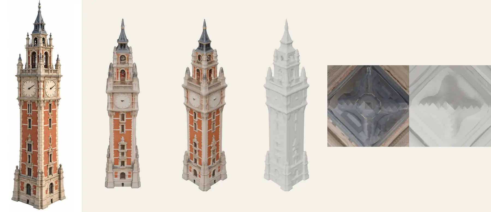

_Left to right: the reference, front textured, three-quarter textured, three-quarter clay, top
textured, top clay._

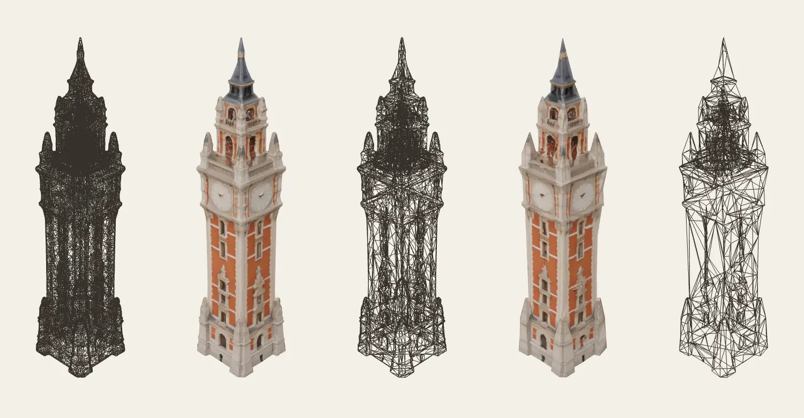

_Left to right: 40k wireframe, 10k textured, 10k wireframe, 2.5k textured, 2.5k wireframe._

- **Silhouette.** Faithful. The proportions, the four corner turrets at the clock stage, the
  tiered lantern and the spire all match the reference. The lantern's openings are shallower than
  drawn: arches read as recesses, not as see-through.
- **Texture.**
  - Strong on the faces the reference shows: the brick, the stone banding, the window surrounds,
    and the clocks with no numerals.
  - Lighting from the reference is baked into the albedo, so it double-shades a little under the
    scene's sun.
  - The unseen top is smeared (the top views), which is invisible from the tour's camera
    elevations.
- **Topology.**
  - A marching-cubes triangle soup, 40k triangles, not quads: fine for display, not for editing.
  - meshoptimizer simplifies it cleanly: the 10k LOD is visually identical, and the 2.5k LOD
    keeps the silhouette at board scale, with the texture carrying the detail.

**Cleanup, measured.**

- **Geometry.** `meshoptimizer` from the repo's `node_modules`: `simplify` with `LockBorder` to
  keep UV seams, then quantised vertices (int16 position, int8 normal, uint16 UV: 16 bytes) and
  `encodeVertexBuffer` / `encodeIndexBuffer`. That is the payload `EXT_meshopt_compression` ships.
- **Textures.** Re-encoded with `sharp`.

| Triangles             | Vertices | Raw geometry | Meshopt-encoded | + gzip | Simplify error |
| --------------------- | -------- | ------------ | --------------- | ------ | -------------- |
| 40,000 (as generated) | 27,001   | 912 KB       | 305 KB          | 269 KB | 0              |
| 20,000                | 15,677   | 491 KB       | 178 KB          | 161 KB | 0.0007         |
| 10,000                | 9,250    | 268 KB       | 105 KB          | 95 KB  | 0.0016         |
| 5,000                 | 5,147    | 142 KB       | 58 KB           | 53 KB  | 0.0029         |
| 2,500                 | 3,038    | 79 KB        | 33 KB           | 30 KB  | 0.0088         |

| Texture            | As generated    | WebP q80 2048 | WebP 1024 | WebP 512 | JPEG (mozjpeg q82) 1024 |
| ------------------ | --------------- | ------------- | --------- | -------- | ----------------------- |
| Base colour        | 1,332 KB (JPEG) | 390 KB        | 164 KB    | 59 KB    | 202 KB                  |
| Metallic-roughness | 2,080 KB (PNG)  | 36 KB         | 12 KB     | 4 KB     | 21 KB                   |

- **Totals.** The belfry goes from 6.1 MB to about 280 KB at 10k triangles with 1024² WebP
  textures, and to about 95 KB at 2.5k with 512² for phones.
- **Not measured: KTX2 and Draco.** No KTX2 encoder (`toktx` or `basisu`) is installed, and the
  repo has Draco's decoder but not its encoder. The permission classifier blocked fetching
  `@gltf-transform/cli` through `npx`.
  - KTX2 matters for GPU memory more than for bytes. A 2048² RGBA texture with mips is about
    22 MB uploaded uncompressed, against about 5.6 MB as a BC7 or ASTC transcode of UASTC, and
    about 2.8 MB from ETC1S.
  - Expect ETC1S files near the WebP sizes, and UASTC files 2–4× larger before supercompression.
    These are format facts, not measurements of this mesh.

### 5.4 Recommendation, and what is left to run

- **For now.** Hunyuan3D-2.1 is the measured choice for the tall masonry landmarks: the belfry
  and the Mole.
- **What decides the rest.** TRELLIS.2 is the main open comparison. It is newer, and its
  1024–1536 resolution suits fine ornament and the Bourse's open arcades. Rerun the bake-off
  before fixing a model per landmark type:
  - tall masonry (belfry, Mole);
  - wide facades (Bourse courtyard, school, office);
  - the jetty.
    The plume, the lake and the mountains stay code or particles.
- **The cleanup pipeline**, as one `scripts/` step:
  1. `gltf-transform` `weld` → `simplify --ratio` to 10k triangles (with a 2.5k LOD) → `resize`
     1024 → `etc1s`/`uastc` → `meshopt` → `prune`.
  2. Bake AO in Blender, or keep the generator's baked shading and rely on N8AO.
  3. Record each asset in `docs/path-assets.md`.
     This needs `@gltf-transform/cli` as a dev dependency and KTX-Software's `toktx` installed, and
     both need approval (§6).
- **Rerun commands**, after the ZeroGPU quota resets (about 23:40 UTC on 2026-10-29, from the
  refusals), or once the owner adds HF PRO:

```bash
cd /tmp/orch-path-v2/bakeoff
for m in hunyuan21 trellis2 triposg sf3d; do
  for l in lille-belfry mole-antonelliana; do .venv/bin/python gen3d.py $m $l; done
done   # appends every attempt to log.jsonl
cd /Volumes/Code/Personal/Lorenzo-Germini/.claude/worktrees/path-v3-benchmark
node /tmp/orch-path-v2/bakeoff/measure/measure.mjs /tmp/orch-path-v2/bakeoff/out/<model>/<landmark>.textured.glb
node /tmp/orch-path-v2/bakeoff/measure/render.mjs /tmp/orch-path-v2/bakeoff/out/<model>/<landmark>.textured.glb /tmp/orch-path-v2/bakeoff/renders/<model>-<landmark>
```

SF3D needs its `/requires_bg_remove` call first in the same client. If it still fails, duplicate
the Space to see the hidden error.

## 6. What I could not inspect, and why

- **Sound.** Every browser was muted (`--mute-audio`), so the audio is described from the files,
  their names and sizes, and the code (Howler, the audio worker). None of it was heard.
- **Bruno's shaders.** 200 WGSL modules were captured, but TSL strips names, so the effect list
  comes from the JS bundle's identifiers (`bloom`, TAA, tone mapping), not from the shaders. The
  tilt-shift is read from the frames.
- **Bruno's 20 s ring.** I could not establish whether it was loading or waiting for input under
  automation.
- **igloo's three.js version** comes from a `"165"` revision string in `App3D`. jesse's r139 and
  Bruno's r183 come from `REVISION =` in their bundles.
- **v2's bytes.** v2 ran on the dev server (unminified), so its JS bytes are not comparable;
  production figures are in `docs/path-measurements.md`.
- **The bake-off.** Only Hunyuan3D-2.1 on the belfry ran (§5.2). TRELLIS.2, TripoSG and Stable
  Fast 3D were not run for quota or upstream errors, and SPAR3D's Space does not build.
- **KTX2 and Draco sizes** were not measured, for want of encoders: the classifier blocked
  `npx @gltf-transform/cli`, and `toktx` is not installed.
